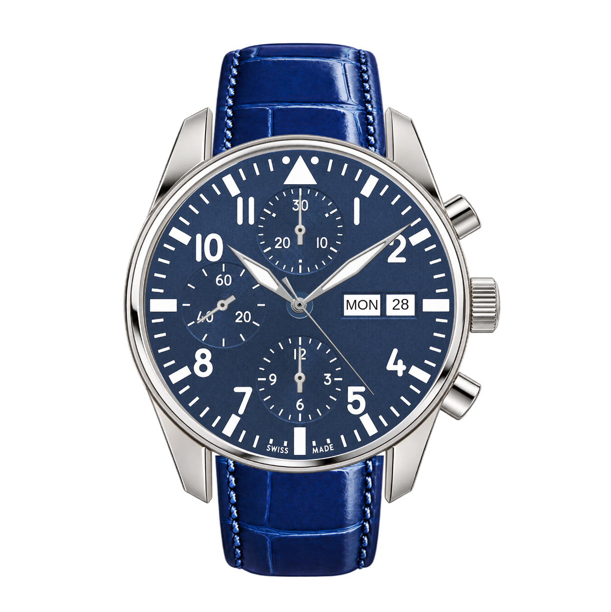

# Proposition Watchys — bleu / bleu / chromé / poli

**Branche de travail : `watchys/generated-preview`.** La version existante, ses 40 compositions à 490 CHF et son panier persistant restent conservés. Cette proposition n'est pas publiée sur GitHub Pages.



[Ouvrir l'image de validation en pleine définition](public/review/blue-blue-chrome-polished.png)

## Voir les calques interactifs localement

```sh
npm start
```

Ouvrir `/public/review/index.html` sur le serveur local, port 5173. Le lien racine conserve l'ancien configurateur. Dans « Examiner les calques du rendu », masquer un composant pour inspecter son indépendance, puis « Tout afficher » pour restaurer l'assemblage. La visibilité de chaque calque est indépendante : aucun recalcul de taille des autres composants.

## Origine et construction

Les 10 PNG transparents du ZIP utilisateur `7750.zip` sont conservés sans modification sous `public/generated-7750/`. La première composition utilise uniquement le cadran bleu, le bracelet bleu fermé, la carrure polie et le jeu chromé. Les autres fichiers sont archivés pour la suite, sans nouvelle déclinaison assemblée.

`src/generated-pilot.js` définit les repères fixes et les placements dans un carré de 1254 pixels. Le cadran est centré en `(615,625)`, rayon `318`. Chaque composant est un PNG indépendant. Le jeu d'aiguilles est réparti entre les heures/minutes/trotteuse et les trois compteurs : les pivots sont placés sur les axes du cadran. Le bracelet fermé utilise deux zones visibles de son image, adaptées aux entrecornes et cachées derrière la carrure. Le jour/date MON/28 est un affichage de démonstration, pas une mécanique simulée.

`public/review/blue-blue-chrome-polished.png` est une capture du vrai assemblage SVG dans le navigateur, en 1254 × 1254. Ce n'est pas une nouvelle montre générée en une seule image. Les vignettes de la page montrent uniquement leur composant, dans une fenêtre commune.

## À valider avant les autres variantes

- Proportions, cadrage de face et bracelet fermé.
- Teinte/texture du cadran et du cuir, raccords aux entrecornes et qualité des reflets.
- Aiguilles à intérieur blanc vers 10 h 10, trotteuse chromée fine sans boule vers 4–5.
- Lisibilité des inscriptions et compteurs, dont SWISS MADE présent dans le nouveau fichier.

Les composants restent des visuels générés : textures, reflets, formes exactes, petits contrepoids et détourage doivent être comparés aux photographies réelles. La transparence de l'orifice central est présentée sur un fond bleu neutre sous le moyeu. Les ombres et reflets d'un assemblage 3D physique ne sont pas recalculés. Ne pas considérer ce rendu comme une photo contractuelle.

Pour les cinq couleurs, le ZIP contient seulement les cadrans bleu et noir. Les références originales vert, anthracite et gris clair sont conservées, mais leurs nouveaux rendus générés attendent la validation de cette première direction visuelle.

## Révision du bracelet après la référence de montage

Le cadran, la carrure, les aiguilles et MON/28 conservent leurs repères approuvés. Seul le bracelet est révisé : un nouveau calque transparent `strap-blue-closed-fitted.png` reprend le cuir bleu en supprimant les gros replis latéraux et en rapprochant les coutures des bords. Il s'agit d'une adaptation générée, pas d'une extraction exacte de l'image de référence. L'original du ZIP reste disponible sans modification.

Les deux extrémités sont centrées sur l'axe 615, avec une largeur commune de 360 pixels. Le haut occupe les coordonnées `(435,88)` à `(795,335)` et le bas `(435,934)` à `(795,1184)`, derrière la carrure. Les zones visibles du cuir sont recadrées pour se rapprocher des deux panneaux de la référence. La date reste affichée conformément au prototype ; son absence dans la référence n'est pas reprise.

Le contrôle de captures avant/après vérifie que tous les pixels hors des zones du bracelet sont identiques. La silhouette et les raccords restent soumis à validation visuelle avant les autres variantes.
